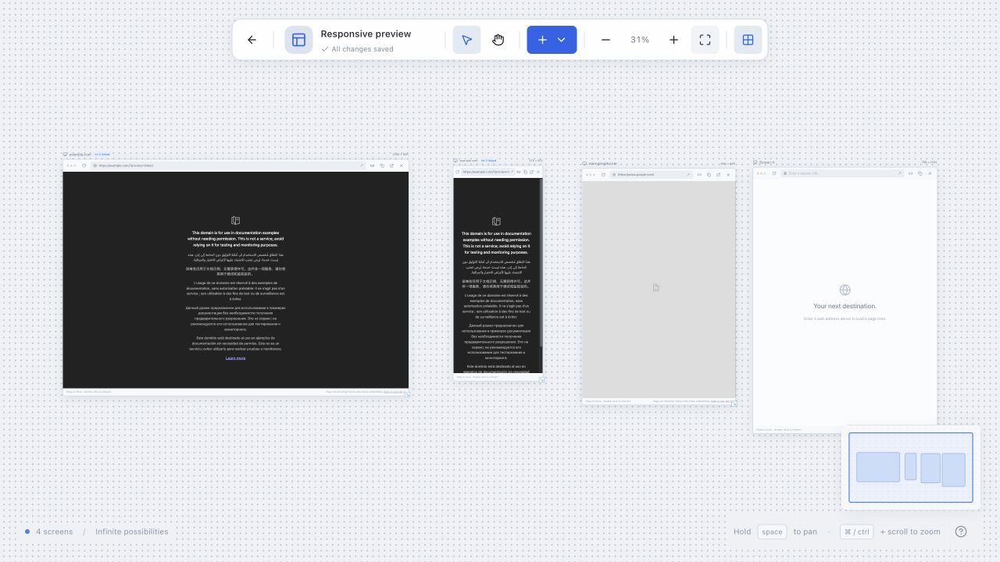
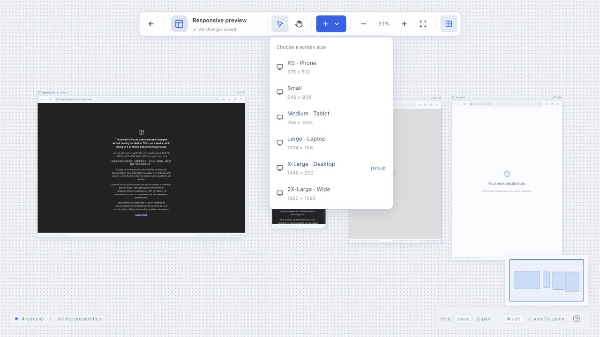
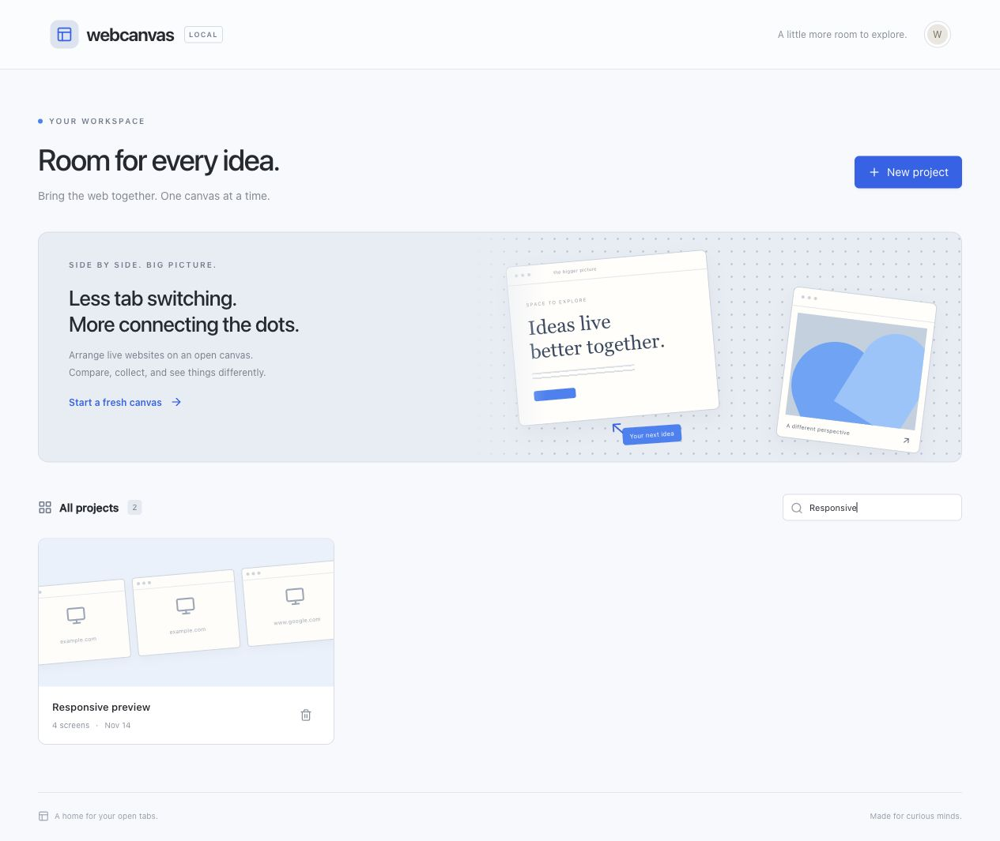

# Webcanvas

Arrange live websites side by side on an infinite canvas. Create separate projects, compare responsive layouts, and keep related screens linked to the same address.

Built with **Laravel 13, Inertia 2, React 19, TypeScript, Tailwind CSS 4, and shadcn/ui (Radix)**. Projects and canvas layouts are saved in SQLite.

## Screenshots

### Canvas

Move and resize screens freely, navigate with the compact minimap, and control your workspace from the centered toolbar.



### Screen presets

Choose a size from the **+ dropdown** to add a blank screen immediately—no setup modal.



### Projects

Create, search, rename, and delete project canvases.



## Features

- **Project library:** each project has its own canvas, screens, and saved viewport.
- **Movable, resizable screens:** drag the title, browser chrome, blank content, or inactive website area; resize from the bottom-right corner.
- **Responsive size presets:** add phone, tablet, laptop, desktop, and wide screens directly from the toolbar.
- **Linked screens:** share one address across multiple screens while keeping their sizes and positions independent.
- **Live website interaction:** choose **Interact with website** to use its links and forms. Click the canvas to return to arranging screens.
- **Canvas navigation:** double-click a screen to fit it, pan, zoom from 10–200%, reset to 100%, and fit all screens.
- **Compact minimap:** see the current viewport and navigate by clicking, dragging, or focusing it and using arrow keys.
- **Right-click quick menu:** add a desktop screen, switch Select/Pan tools, adjust zoom, fit screens, or return to projects.
- **Centered toolbar:** project name, save status, back navigation, tools, and a show/hide dot-background toggle.
- **Screen controls:** edit URLs, reload, duplicate, link/unlink, open in a new tab, and delete.
- **Automatic saving:** screen URLs, links, positions, dimensions, project names, and canvas viewport persist. Failed saves offer a retry action.

### Screen sizes

| Preset | Width × height |
| --- | --- |
| XS · Phone | 375 × 812 |
| Small | 640 × 900 |
| Medium · Tablet | 768 × 1024 |
| Large · Laptop | 1024 × 768 |
| X-Large · Desktop (default) | 1440 × 900 |
| 2X-Large · Wide | 1920 × 1080 |

Dimensions describe the website content viewport in CSS pixels, excluding the screen chrome. All presets remain freely resizable.

### Linking screens

1. Add two or more screens and enter a website address in one screen's address bar.
2. Click the **chain icon** on the screen you want to link.
3. Under **Use the website from**, choose another screen and click **Link screen**.
4. Change the address in any linked screen to update the entire group.

Repeat to join more screens to a group. To disconnect one, click its chain icon and choose **Unlink this screen**. Linking adopts the chosen screen's address. Navigation or clicks *inside* a website are independent and do not synchronize.

### Shortcuts

| Action | Shortcut |
| --- | --- |
| Select tool | `V` |
| Pan tool | `H` |
| Temporarily pan | Hold `Space` and drag |
| Pan canvas | Drag background or scroll |
| Zoom around the pointer | `Ctrl` / `Cmd` + scroll |
| Zoom in / out | `+` / `−` |
| Fit all screens | `0` |
| Actual size (100%) | `1` |
| Exit website interaction / clear selection | `Escape` |

## Run locally

### Requirements

- PHP **8.3+** with Laravel's required extensions, including SQLite support (`pdo_sqlite`). Development uses PHP 8.4.
- Composer **2**.
- Node.js **24 LTS** and npm (recommended; also supports the included TypeScript test runner).
- Git.

No separate database server is needed.

### Install

```sh
git clone https://github.com/cesardg21/webcanvas.git
cd webcanvas
composer install
npm ci
```

Create the local environment file and SQLite database. These commands work without overwriting an existing environment or database:

```sh
php -r "file_exists('.env') || copy('.env.example', '.env');"
php -r "file_exists('database/database.sqlite') || touch('database/database.sqlite');"
php artisan key:generate
php artisan migrate
npm run build
```

Run `key:generate` once during initial setup. The example environment already selects SQLite and the database-backed session/cache drivers.

### Start the app

```sh
php artisan serve --host=127.0.0.1 --port=8000
```

Open [http://127.0.0.1:8000](http://127.0.0.1:8000). Create a project, choose a size from the **+ dropdown**, and type a URL into the new screen's address bar.

For frontend hot reload, keep Laravel running and open another terminal in the project directory:

```sh
npm run dev
```

Continue using the Laravel URL, not the Vite server URL. Without Vite running, the app serves the assets from the latest `npm run build`.

### Troubleshooting

- **Missing Vite manifest:** run `npm run build` or start `npm run dev`.
- **Missing database/table:** create `database/database.sqlite` using the command above, then run `php artisan migrate`.
- **SQLite driver missing:** enable/install your PHP installation's SQLite extension.
- **Stale assets after stopping Vite:** if `public/hot` remains after an interrupted dev server, remove that file and run `npm run build`.
- **Website refuses to load:** use its **open in new tab** control. Some websites prohibit embedding.

## Checks

```sh
npm run check
npm run build
php artisan test
```

`npm run check` runs Prettier, ESLint, TypeScript, and frontend unit tests. Use `npm run format` to format frontend code and `npm run lint:fix` to apply safe lint fixes. ESLint enforces unused-variable checks, type-only imports, React Hooks dependencies, and Fast Refresh exports.

PHP feature tests cover project lifecycle, canvas persistence, linked-screen metadata, and validation using an isolated in-memory SQLite database. TypeScript unit tests cover shared URL updates, independent screen geometry, unlinking, and joining groups.

## Scope and limitations

- **Local, single-user app:** there is no authentication or project ownership. Everyone using the same server sees the same library. Keep the server bound to loopback; add authentication and authorization before hosting it for others.
- **Browser embedding rules apply:** websites with restrictive CSP `frame-ancestors` or `X-Frame-Options` cannot be embedded. Webcanvas does not bypass these rules. Browser policies also govern cookies, login sessions, popups, and mixed content.
- **URL linking is address-bar synchronization:** cross-origin navigation inside an iframe cannot be read by the parent app, so internal website clicks do not update the shared address.
- **Limits:** up to 100 screens per project, widths of 320–3840 pixels, and heights of 240–2160 pixels. Many live websites can consume substantial memory.
- **Concurrent edits:** open canvases check for external changes while idle. Stale saves are rejected; a notice lets you explicitly discard local edits and load the latest canvas. External refreshes clear local undo history. Undo/redo covers the current editing session.
- **Local data:** `.env`, the SQLite database, logs, and installed dependencies are excluded from Git. Screenshots are illustrative; no sample projects are seeded on installation.

## Connect Codex through MCP

Webcanvas includes a local **stdio MCP server** for listing, reading, creating, and updating projects. Codex can add, move, resize, link, style, and remove canvas objects. It edits canvas data, not the contents of embedded websites. Images can reuse a path already uploaded through the app.

Run `composer install` (including development packages) and `php artisan migrate` first. The MCP package currently comes with the local Laravel Boost development tools; this is not a production MCP deployment.

Register the server from this repository's directory:

```sh
codex mcp add webcanvas -- "$(command -v php)" "$PWD/artisan" mcp:start webcanvas
```

Codex starts the process when needed; there is no MCP port or separate daemon to keep running. Keep the normal Laravel app running to view the canvas. Restart Codex or open a new session after registration if the tools do not appear. See [Codex MCP configuration](https://developers.openai.com/codex/mcp).

Example prompts:

- “List my Webcanvas projects.”
- “In my Responsive preview project, add linked desktop and phone screens for https://example.com.”
- “Add a yellow sticky note beside those screens with a launch checklist.”
- “Put a translucent blue rectangle behind these screens and label it Homepage.”

The tools are `list_projects`, `get_project`, `create_project`, and `update_project`. Updates require the revision returned by `get_project`. Supplied screens/items arrays replace those arrays, so the agent must preserve objects it is not changing. Conflicting updates are rejected and must be reread before retrying. An idle open canvas picks up changes within a few seconds; refresh the project library to see newly created projects.
